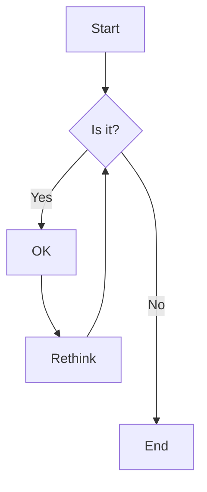



Here is an example of headings. You can use this heading by the following markdown rules. For example: use `#` for heading 1 and use `######` for heading 6.

# Heading 1

## Heading 2

### Heading 3

#### Heading 4

##### Heading 5

###### Heading 6

---

### Emphasis

The emphasis, aka italics, with _asterisks_ or _underscores_.

Strong emphasis, aka bold, with **asterisks** or **underscores**.

The combined emphasis with **asterisks and _underscores_**.

Strike through uses two tildes. ~~Scratch this.~~

---

### Button



---

### Link

[I'm an inline-style link](https://www.google.com)

[I'm an inline-style link with title](https://www.google.com "Google's Homepage")

[I'm a relative reference to a repository file](../blob/master/LICENSE)

URLs and URLs in angle brackets will automatically get turned into links.
<http://www.example.com> or <http://www.example.com> and sometimes
example.com (but not on Github, for example).

Some text to show that the reference links can follow later.

---

### Paragraph

Lorem ipsum dolor sit amet consectetur adipisicing elit. Quam nihil enim maxime corporis cumque totam aliquid nam sint inventore optio modi neque laborum officiis necessitatibus, facilis placeat pariatur! Voluptatem, sed harum pariatur adipisci voluptates voluptatum cumque, porro sint minima similique magni perferendis fuga! Optio vel ipsum excepturi tempore reiciendis id quidem? Vel in, doloribus debitis nesciunt fugit sequi magnam accusantium modi neque quis, vitae velit, pariatur harum autem a! Velit impedit atque maiores animi possimus asperiores natus repellendus excepturi sint architecto eligendi non, omnis nihil. Facilis, doloremque illum. Fugit optio laborum minus debitis natus illo perspiciatis corporis voluptatum rerum laboriosam.

---

### Ordered List

1. List item
2. List item
3. List item
4. List item
5. List item

---

### Unordered List

- List item
- List item
- List item
- List item
- List item

---

### Notice


This is a simple note.



This is a simple quote.



This is a simple tip.



This is a simple info.



This is a simple warning.


---
### 🎯 역량과 적용 사례 {#competencies}





#### 글로벌 소통 역량

프랑스어 전공 수업을 수강하며 외국인 교수님과 꾸준히 대화를 나누고 작성한 글과 발표에 대해 구체적인 피드백을 주고받는 정교한 소통 방식을 연습했습니다. 이 과정에서 언어적 장벽을 넘어 복잡한 생각을 상대방의 눈높이에 맞춰 명확하게 전달하고 경청하는 태도를 몸소 익혔습니다.





#### 개발 프로세스 및 시스템 기술 이해도(C, C++, Python, Linux)

Ubuntu Linux 기반에서 구조체와 바이너리 파일 입출력을 활용한 계정 관리 시스템 프로그램을 직접 구현하며 시스템 하부의 데이터 처리 방식을 깊이 이해했습니다. 또한 VS Code와 Git/GitHub를 활용해 빌드부터 버전 관리까지의 실무적 개발 프로세스를 체득했습니다.





#### 데이터 기반 문제 해결

데이터분석준전문가(ADsP) 자격을 취득하는 과정에서 정량적 지표를 다루는 방법론을 배우고, 감이나 단순 추측이 아닌 객관적 데이터에 기반해 문제를 바라보는 시각을 확립했습니다. 프로젝트 진행 중 예기치 않은 변수나 오류가 발생할 때마다 수집된 로그와 지표 데이터를 분석하여 문제의 근본 원인을 논리적으로 추적했습니다. 



---

### Accordions



- Lorem ipsum dolor sit amet consectetur adipisicing elit.
- Lorem ipsum dolor sit amet consectetur adipisicing elit.
- Lorem ipsum dolor sit amet consectetur





- Lorem ipsum dolor sit amet consectetur adipisicing elit.
- Lorem ipsum dolor sit amet consectetur adipisicing elit.
- Lorem ipsum dolor sit amet consectetur





- Lorem ipsum dolor sit amet consectetur adipisicing elit.
- Lorem ipsum dolor sit amet consectetur adipisicing elit.
- Lorem ipsum dolor sit amet consectetur



---

### Code and Syntax Highlighting

This is an `Inline code` sample.

```javascript
var s = "JavaScript syntax highlighting";
alert(s);
```

```python
s = "Python syntax highlighting"
print s
```

```c  { linenos=true }
#include <stdio.h>

int main(void)
{
    printf("hello, world\n");
    return 0;
}
```



---

### Blockquote

> Did you come here for something in particular or just general Riker-bashing? And blowing into maximum warp speed, you appeared for an instant to be in two places at once.

---

### Tables

| Tables        |      Are      |  Cool |
| ------------- | :-----------: | ----: |
| col 3 is      | right-aligned | $1600 |
| col 2 is      |   centered    |   $12 |
| zebra stripes |   are neat    |    $1 |

---

### Image



---

### Gallery



---

### Slider



---

### Youtube video



---

### Custom video


